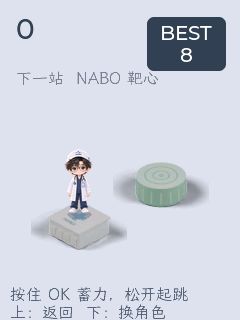

# AI Passport · NABO × 小智

为 **FoloToy AI Passport（ESP32-C3 / 8 MB）**制作的小智定制固件：NABO 待机与对话动画、跳一跳、节奏回声、摇骰子、功德木鱼、网络电台、蓝牙电脑快捷键，以及完整的设备设置。

**当前版本：v1.3.1，2026-10-16。** 滑动遥控新增微信读书左右翻页：双击上键上一页、短按 OK 下一页，上下滑动和长按 OK 退出保留。27 个电脑操作保留旧版自定义映射；从 v1.3.0 升级无需因本次改动重新配对。发布的同一份应用已刷入工牌，通过写入、启动与截屏检查，并由用户确认微信读书四项操作均正常。小智上游的应用版本字符串仍为 `2.5.0`；本项目的发行版本为 `v1.3.1`。

[下载固件](https://github.com/Liutupi/ai-passport-nabo-xiaozhi/releases/latest) · [使用指南](docs/USER_GUIDE.md) · [刷写说明](docs/FLASHING.md) · [编译说明](docs/BUILD.md) · [维护交接](docs/HANDOFF.md) · [验证记录](docs/VALIDATION.md)



## 已实现

| 功能 | 行为 |
|---|---|
| 小智 + NABO | 224×224 半身原图，待机眨眼，聆听、思考、说话切换动画 |
| 语音打开 | 对话中说“打开摇骰子／木鱼／网络电台／跳一跳／节奏回声／电脑快捷键／设置” |
| 跳一跳 | 按住 OK 蓄力、松开起跳；NABO 屈膝摆臂、落地站稳、平台旁跌坐结束；支持连续蓄力。越往后间距越大、平台越小，后期出现咖啡杯、电脑、音箱、黑胶等“一人位”小平台 |
| 节奏回声 | 先听一小节示范再拍回去；回声 / 对唱 / 混合 × 4 关，88–120 BPM，PERFECT 判定与最好成绩 |
| 个性平台 | 医院、书房、播客、木鱼、值班咖啡、靶心；迷你版与 6 种一人位小物 |
| 骰子 / 木鱼 | 延续此前 NABO 工牌的声音和操作方式，保存累计功德 |
| 网络电台 | 47 台目录、分类与收藏、播放控制 |
| 电脑控制 | BLE 键盘 + 媒体键 + 滚轮鼠标：滑动遥控（上下滑动、双击上键上一页、短按 OK 下一页、长按 OK 退出），27 个操作分 4 组，Windows / Mac 映射，可反转滚动方向 |
| 导航 / 设置 | 普通页面双击右侧上键返回上一级、长按上键回小智；滑动遥控页按上述独立规则操作；音量、亮度、休眠、网络等 |

明确的打开命令在语音识别结果到达后由设备直接处理；复杂表达仍可通过 `self.apps.open` MCP 工具执行。进入本地程序会暂停小智，长按右侧上键恢复小智。C3 版通过 OK 开始对话，未启用本地唤醒词。

## 下载与安装

Release 提供独立应用 `xiaozhi.bin`、包含四个分区镜像的安装 ZIP、`manifest.json` 和 `SHA256SUMS.txt`。ZIP 内附使用文档及带设备身份检查、备份和写后校验的刷写工具。

- **本定制版已安装：** 使用应用升级，仅写 `0x10000`，保留配网、激活、资源及用户数据。
- **首次安装：** 使用安装包中的四个独立镜像；先核对芯片、Flash、分区和备份。不会执行整片擦除。

此固件只适配上述工牌，采用单应用自定义分区。官方标准 OTA 镜像与这个布局不兼容。请按[刷写说明](docs/FLASHING.md)操作，不要把 ZIP 当成整片 Flash 备份写入。

## 源码与构建

基于 [78/xiaozhi-esp32](https://github.com/78/xiaozhi-esp32) 的 `4632dc51f0a5ad26e08542e131e6e48da41e4ff3`，完整源码位于 `xiaozhi-esp32/`。本版使用 **ESP-IDF 6.0.2**、ESP32-C3、中文语言资源；组件锁定文件和发行配置一并保留。

```powershell
# 在已初始化的 ESP-IDF 6.0.2 终端中
python tools/build.py
```

宿主回归测试需要 Python 3.11+、GCC/G++ 和 Pillow：

```powershell
python -m pip install -r requirements-dev.txt
python tools/run_tests.py
```

## 交接入口

先阅读 [HANDOFF.md](docs/HANDOFF.md)：它说明源码职责、音频与网络生命周期、已有问题的修复原因、回归测试和下一版发布流程。`validation/` 只保存去除设备标识和私人内容的验证摘要；仓库和 Release 不包含 NVS、设备整片备份、Wi-Fi 信息、账号令牌或对话日志。

源码、解码器、字体及美术/音频素材的来源与许可分别列在 [THIRD_PARTY_NOTICES.md](THIRD_PARTY_NOTICES.md)。NABO 美术与社区音效不因源码的 MIT 许可证而自动变成 MIT 素材。本项目是独立定制项目，与微信及 FoloToy 官方发行无关联。
